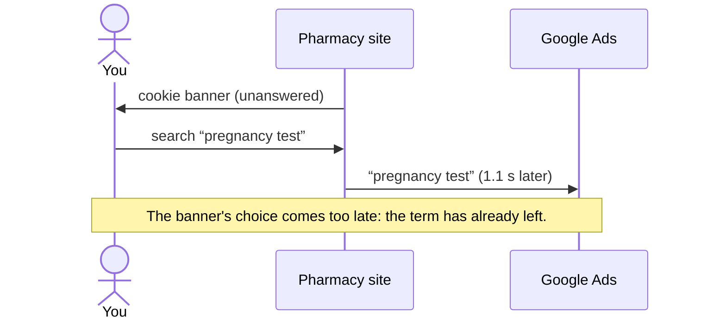
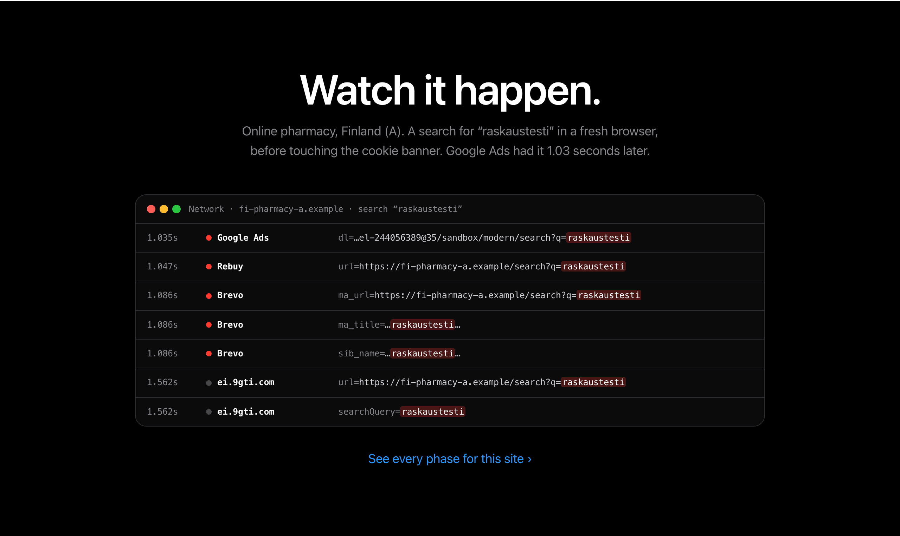
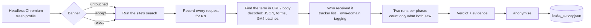

# Firstbite

[](https://github.com/danielnurm/firstbite/actions/workflows/check.yml)

You open your pharmacy's website and search for “pregnancy test”. The cookie banner is still on screen; you
haven't said yes to anything. One second later, the search has reached Google Ads.

That happened on a UK online pharmacy, and Firstbite is the tool that caught it. It runs a site's search in a
real browser and shows which ad and analytics companies receive what you typed, before and after you answer the
cookie banner, with the exact request as proof.



## Why it matters

- **A health search is about as private as a website visit gets.** What you type into a pharmacy or clinic
  search says what you think you have.
- **The banner promises a choice.** On 7 of the 20 sites we could check, the term reached ad or
  analytics companies before that choice was made, and on 7 of 16 it still did after the
  visitor pressed reject.
- **The usual checks miss it.** Cookie scanners list cookies, not what you typed. On 7 sites part of the
  data went through the site's own domain, where ad blockers and scanners don't look.

**Who it's for:** developers and privacy officers of health sites, who can check their own site in about two
minutes, and anyone who wants to see what a search gives away.


## The finding (one day, 2026-11-16, run from Finland)

We checked 34 sites: 27 online pharmacies and 7 private clinics in Finland, Sweden, Norway, Denmark, Germany and
the UK. Each site gets its worst result:

| Worst result per site | Sites |
|---|---|
| Sent the search before the cookie banner was answered | 7 |
| Sent it after the visitor rejected cookies | 3 |
| Sent it only after the visitor accepted cookies | 7 |
| Not sent to any ad or analytics company | 3 |
| Couldn't check (no real search could be run on 9, a bot wall on 4, no accept button found on 1) | 14 |

Rejecting is measured separately too: of the 16 sites where a reject button could be pressed,
7 still sent the term afterwards. (The table shows fewer, because most of those already sent it before
consent.)

- Google Analytics received the search on 14 sites (4 before consent), Google Ads on 12 (3 before).
- On 7 sites part of it went through the site's **own domain** (server-side tagging).
- A search counts only if the results page shows the term. Where the checker couldn't run a real search, the site
  is “couldn't check”, never “not sent” (the 9 above).
- Re-checking two sites by hand (one “sent before consent”, one “not sent”) gave the same verdict and the same
  recipients in every phase.



Sites are labelled by type and country (“Online pharmacy, Germany (A)”) on purpose: the point is the pattern,
not any one company. The recipient companies are named.


## How it works



Each phase records every request that carries the term in the six seconds after the search, and checks that the
search really ran (the results page shows the term). A search that didn't run makes the phase “couldn't check”,
never “not sent”.

- `backend/leaks.py`: the browser check, the three phases, verdicts, the survey and anonymisation.
- `backend/payload.py`: finds the term in any request (URL, form, JSON, GA4's batched lines), keeping ±40 characters.
- `backend/trackers.py`: who a request goes to; site search, consent and chat tools are shown but not counted.
- `api/main.py`: FastAPI. `DEMO_MODE=1` serves the saved survey; live checks only with `ALLOW_LIVE=1`, one at a
  time, public hosts only.
- `web/`: React + TypeScript + Tailwind (design notes in `web/README.md`).
- `demo/search_site/`: a fake pharmacy with a banner, a search box and a fake tracker, used by the browser test.

## Architecture decisions

| Decision | Alternative we considered | Why |
|---|---|---|
| A real headless browser | Plain HTTP fetches | Trackers load through JavaScript and Tag Manager; only a browser shows what a visitor's browser sends. |
| Two runs per phase, count only what both saw | One run | Tracker calls can vary from load to load, so a one-off request never becomes a finding. |
| Count the site's own domain when it's a tracker endpoint | Ignore first-party requests | Server-side tagging forwards data from the site's own domain, the blind spot of blocklist scanners. |
| Check every browser request against private addresses | Check only the entered host | A public site can redirect to an internal address; the guard runs inside the browser, on every request. |
| Anonymise sites, name the recipients | Publish site names | A portfolio project doesn't need to accuse anyone; the pattern is the finding. Named results stay in a gitignored folder. |
| No LLM in verdicts or copy | Generate explanations | Every finding on the page traces to a recorded request. |

## Run it

Python 3.12, and Node 20.19+ or 22.12+ (Vite 8).

```bash
python3.12 -m venv .venv && .venv/bin/pip install -r requirements.txt
.venv/bin/python -m playwright install chromium

DEMO_MODE=1 .venv/bin/uvicorn api.main:app --port 8000   # the saved survey, no network
cd web && npm install && npm run dev                       # open the address Vite prints
```

Check a site yourself (live, about two minutes, from your own machine):

```bash
.venv/bin/python -m backend.leaks check example-pharmacy.fi raskaustesti
```

Or try it offline on the fake pharmacy:

```bash
python demo/search_site/server.py 8766
.venv/bin/python -c "from backend import leaks; print(leaks.check_search('127.0.0.1', 'raskaustesti', base_url='http://127.0.0.1:8766/leak/', allow_private=True)['verdict'])"
```

Tests: `.venv/bin/python -m unittest discover -s tests -t .` (unit tests plus the real-browser test against the
fake pharmacy). CI also runs a gitleaks secret scan and the web lint and build.

## Limits

- One day, one country to run from (Finland), and a hand-picked list of sites. Results can differ by country,
  time and logged-in state.
- The checker presents itself as regular Chrome (its user agent has no “Headless”), so sites behave as they do
  for visitors.
- What a company does after receiving the term isn't visible, nor is server-to-server forwarding beyond the
  site's own domain.
- The reject phase needs a reject button the checker can find; on 5 sites it couldn't.
- “Sent” is an observation, not a legal conclusion.

## Team

Built at **Junction 2026** (Espoo, 48 h) as ClientTrace, then reworked into Firstbite.

- **Daniel Nurminen:** the search check, survey and anonymisation, API, web app, and the Firstbite pivot.
- **Elmo Mäkinen:** web archive history and live product detection in ClientTrace.
- **Juho Vartiainen:** customer-name matching and AI analysis in ClientTrace.

The ClientTrace version stays in the git history before the Firstbite merge. Built with Claude Code.

License: MIT, see [LICENSE](LICENSE).
