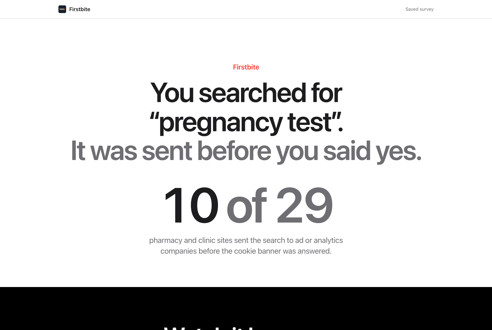
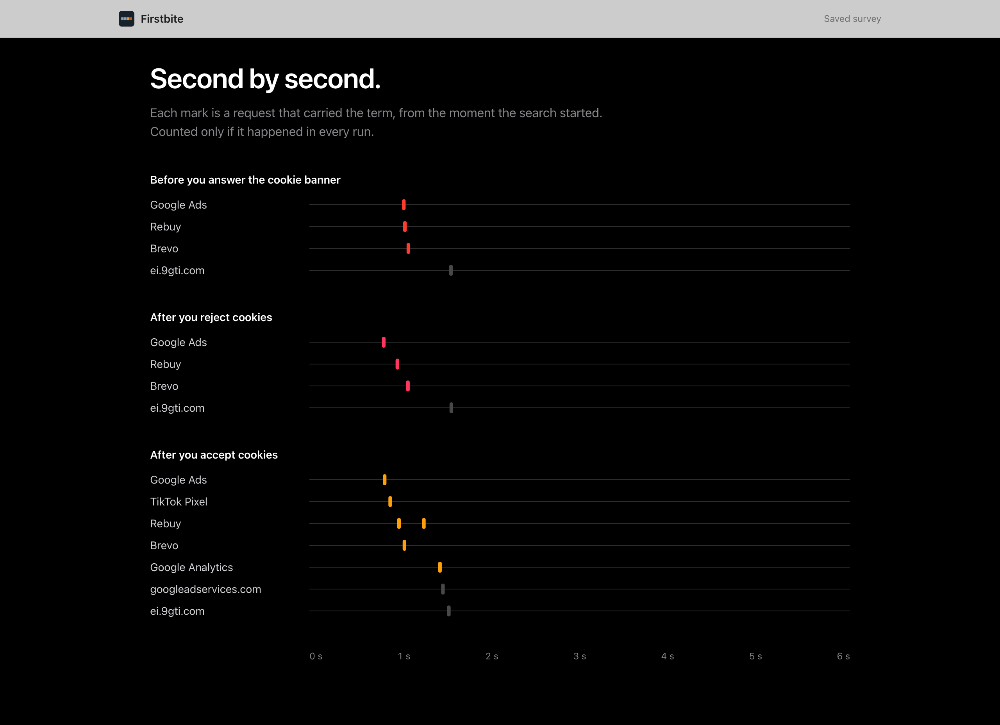
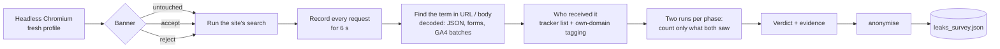

# Firstbite

[](https://github.com/danielnurm/firstbite/actions/workflows/check.yml)

Search a pharmacy site for “pregnancy test” and see which ad and analytics companies receive what you typed,
before and after you answer the cookie banner, with the exact request as proof.

**We checked 34 pharmacy and clinic sites in six European countries. On 10 of the 29 we could check, the search
reached ad or analytics companies before the cookie banner was answered. On 7 of 24, it still did after the
visitor pressed reject.**



## Why it matters

A site search is one of the most private things you type into a website: a pregnancy test, a depression
treatment. Cookie banners promise you a choice, and cookie scanners list which cookies a site sets. Neither
shows what happens to **what you type**. Firstbite opens the site in a real browser, runs the search and records
every request in the next six seconds that carries the term.


## Results (one day, 2026-11-16, run from Finland)

| Result | Sites |
|---|---|
| Sent the search before the cookie banner was answered | 10 |
| Sent it after reject (worst result for the site) | 2 |
| Sent it only after accepting | 10 |
| Not sent to any ad or analytics company | 7 |
| Couldn't check (bot wall, no search, no banner) | 5 |

- Google Analytics received the search on 18 sites (6 before consent), Google Ads on 16 (5 before).
- On 10 sites part of it went through the site's **own domain** (server-side tagging), where ad blockers and
  cookie scanners don't look.
- Of the 24 sites where a reject button could be pressed, 7 still sent the term after rejecting.

Sites are labelled by type and country (“Online pharmacy, Germany (A)”) on purpose: the point is the pattern,
not any one company. The recipient companies are named.



## How it works



- `backend/leaks.py`: the browser check, the three phases, verdicts, the survey and anonymisation.
- `backend/payload.py`: finds the term in any request (URL, form, JSON, GA4's batched lines), keeping ±40 characters.
- `backend/trackers.py`: who a request goes to; site search, consent and chat tools are shown but not counted.
- `api/main.py`: FastAPI. `DEMO_MODE=1` serves the saved survey; live checks only with `ALLOW_LIVE=1`.
- `web/`: React + TypeScript + Tailwind (design notes in `web/README.md`).
- `demo/search_site/`: a fake pharmacy with a banner, a search box and a fake tracker, used by the browser test.

## Architecture decisions

| Decision | Alternative we considered | Why |
|---|---|---|
| A real headless browser | Plain HTTP fetches | Trackers load through JavaScript and Tag Manager; only a browser shows what a visitor's browser sends. |
| Two runs per phase, count only what both saw | One run | Tracker calls can vary from load to load, so a one-off request never becomes a finding. In this survey it removed a company on 1 of 29 sites. |
| Count the site's own domain when it's a tracker endpoint | Ignore first-party requests | Server-side tagging forwards data from the site's own domain, the blind spot of blocklist scanners. |
| Anonymise sites, name the recipients | Publish site names | A portfolio project doesn't need to accuse anyone; the pattern is the finding. Named results stay in a gitignored folder. |
| No LLM in verdicts or copy | Generate explanations | Every sentence on the page traces to a recorded request. |

## Run it

Python 3.12 and Node 22.

```bash
python3.12 -m venv .venv && .venv/bin/pip install -r requirements.txt
.venv/bin/python -m playwright install chromium

DEMO_MODE=1 .venv/bin/uvicorn api.main:app --port 8000   # the saved survey, no network
cd web && npm install && npm run dev                       # open the address Vite prints
```

Check a site yourself (live, about two minutes, from your own machine):

```bash
.venv/bin/python -m backend.leaks check example-pharmacy.fi raskaustesti
```

Or try it offline on the fake pharmacy:

```bash
python demo/search_site/server.py 8766
.venv/bin/python -c "from backend import leaks; print(leaks.check_search('127.0.0.1', 'raskaustesti', base_url='http://127.0.0.1:8766/leak/')['verdict'])"
```

Tests: `.venv/bin/python -m unittest discover -s tests -t .` (unit tests plus the real-browser test against the
fake pharmacy). CI also runs a gitleaks secret scan and the web lint and build.

## Limits

- One day, one country to run from (Finland), and a hand-picked list of sites. Results can differ by country,
  time and logged-in state.
- What a company does after receiving the term isn't visible, nor is server-to-server forwarding beyond the
  site's own domain.
- The reject phase needs a reject button the checker can find; on 6 sites it couldn't, and 4 showed a bot wall.
- “Sent” is an observation, not a legal conclusion.

## Team

Built at **Junction 2026** (Espoo, 48 h) as ClientTrace, then reworked into Firstbite.

- **Daniel Nurminen:** the search check, survey and anonymisation, API, web app, and the Firstbite pivot.
- **Elmo Mäkinen:** web archive history and live product detection in ClientTrace.
- **Juho Vartiainen:** customer-name matching and AI analysis in ClientTrace.

The ClientTrace version stays in the git history (tag `clienttrace-junction`). Built with Claude Code.

License: MIT, see [LICENSE](LICENSE).
