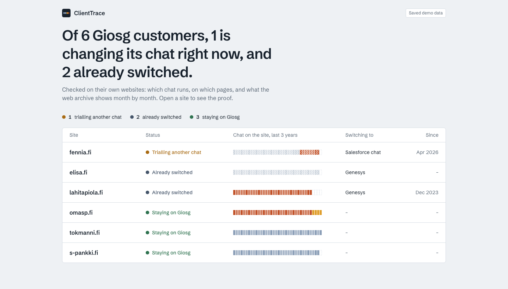
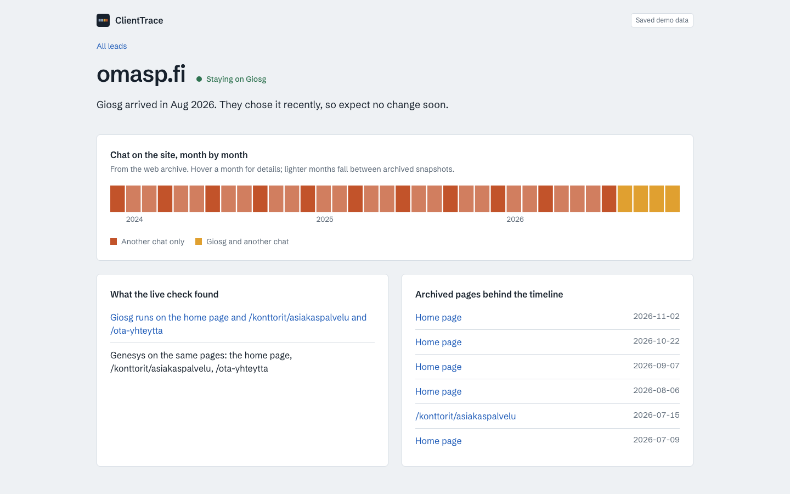

# ClientTrace

[](https://github.com/danielnurm/ClientTrace/actions/workflows/check.yml)

See which of a competitor's customers are switching their chat tool, with proof from their own websites.

Built at **Junction 2026** (Espoo, 48 h) by a team of three, then reworked into a sales tool.



## What it does

A seller at a chat-software company (Boost.ai, Puzzel, Intercom, ...) picks a competitor. ClientTrace takes
that competitor's customers and checks each customer's own website, live and without API credits:

1. the home page and its Google Tag Manager containers (many sites load their chat there)
2. up to two customer-service pages: does another chat run on the **same page** as the competitor's?
3. the privacy or cookie policy: does it **name** the other tool?
4. the help centre's hosting: does it run on the other tool?
5. the web archive: **since when** has each chat been there, month by month?

Every customer gets a plain-language status, hottest first:

| Status | When |
|---|---|
| Leaving the competitor | another chat on the same page **and** the privacy policy or help centre points to it, or the competitor vanished since the last check |
| Trialling another chat | another chat on the same page, **or** named in the privacy policy |
| Already switched | the competitor is gone and another chat runs |
| Weak signal | another chat only on other pages (often another part of the business) |
| Staying on the competitor | only the competitor runs, or it arrived recently |
| Can't tell | no chat visible, or the site isn't reachable |

Each lead opens a detail page with one sentence on why it matters now, the **chat tape** (which chat ran on
the site each month, from the archive), what the live check found, and links to every archived page behind it.



On the six demo sites (Giosg customers in Finland): fennia.fi is trialling Salesforce chat next to Giosg
since April 2026, elisa.fi and lahitapiola.fi have switched to Genesys, and three run only Giosg.

## Run it

Python 3.9+ and Node 20.19+ or 22.12+.

```bash
python3 -m venv .venv && .venv/bin/pip install -r requirements.txt
cp .env.example .env                                         # no keys needed for the demo

DEMO_MODE=1 .venv/bin/uvicorn api.main:app --port 8000       # saved demo data, no network
cd web && npm install && npm run dev                         # open the address Vite prints
```

Without `DEMO_MODE=1` the API checks the sites live (plain HTTP, no credits):
`curl "localhost:8000/api/leads?competitor=Giosg&sites=fennia.fi,elisa.fi"`.

From the command line:

```bash
.venv/bin/python -m backend.leads Giosg tokmanni.fi fennia.fi elisa.fi      # leads, live
.venv/bin/python -m backend.switch_timeline build Giosg fennia.fi           # archive timeline, a few minutes
.venv/bin/python -m api.main snapshot Giosg tokmanni.fi fennia.fi           # refresh the demo snapshot
```

**Live switch demo:** a fake customer site whose chat you switch while the checker watches:

```bash
python -m http.server 8765 -d demo/customer_site                           # terminal 1
.venv/bin/python -m backend.site_tech watch http://localhost:8765 --interval 3   # terminal 2
python demo/switch_chat.py intercom                                        # terminal 3: giosg | intercom | zendesk | none
```

The original hackathon dashboard still runs with `.venv/bin/streamlit run app.py`.

## How it's built

```
backend/site_tech.py         live product detection: page HTML + Tag Manager containers
backend/churn_watch.py       precision checks (same page, privacy policy, help centre) and statuses
backend/switch_timeline.py   month-by-month chat history from the Wayback Machine (cached)
backend/leads.py             the same checks from the seller's side: a competitor's customers as leads
api/main.py                  FastAPI for the web app; DEMO_MODE=1 serves data/leads_demo.json
web/                         React + TypeScript + Tailwind frontend (design notes in web/README.md)
app.py, frontend/            the original Streamlit dashboard
tests/                       offline unit tests: python -m unittest discover -s tests -t .
```

Chat vendors recognised include Giosg, Genesys, Salesforce chat, Zendesk, Intercom and the Nordic Boost.ai,
Puzzel, Humany and Leadoo, each signature verified on a real site.

## Why not customer logo pages

The obvious way to spot a lost customer is to compare a vendor's customer page with the same page in the web
archive. We built that first and measured it:

- **kone.com:** 19 references disappeared since 2023. All of them were still on the site until spring 2026,
  when KONE moved its references to a new site. Lost customers: **0**.
- **zendesk.com:** 4 customers whose stories disappeared all still run Zendesk's help centre. Lost customers: **0**.

Logos leave marketing pages for many reasons, so ClientTrace checks what actually runs on the customer's own
site. The logo comparison is still in the Streamlit dashboard's second tab.

## Limitations

- Logged-in areas and tools that load only after cookie consent aren't visible, so *can't tell* never means
  *doesn't use*. On 37 Nordic banks and insurers a chat tool was visible on 15; the largest banks load their
  chat in a way neither the page nor Tag Manager shows.
- Tag Manager containers are almost never archived, so a chat loaded there is visible live but not in the history.
- Precision is not measured yet. `eval/LABELING.md` describes how to label candidates by hand; the labels file
  is still empty.

## Team

- **Daniel Nurminen:** dashboard and web app, competitor checks and statuses, archive timelines, the sales-lead
  pivot, API, team setup.
- **Elmo Mäkinen:** archive history (Wayback Machine), live product detection, the live switch demo.
- **Juho Vartiainen:** customer-name matching and AI analysis for the logo comparison.

Built with Claude Code. Contributions: see [CONTRIBUTING.md](CONTRIBUTING.md).
